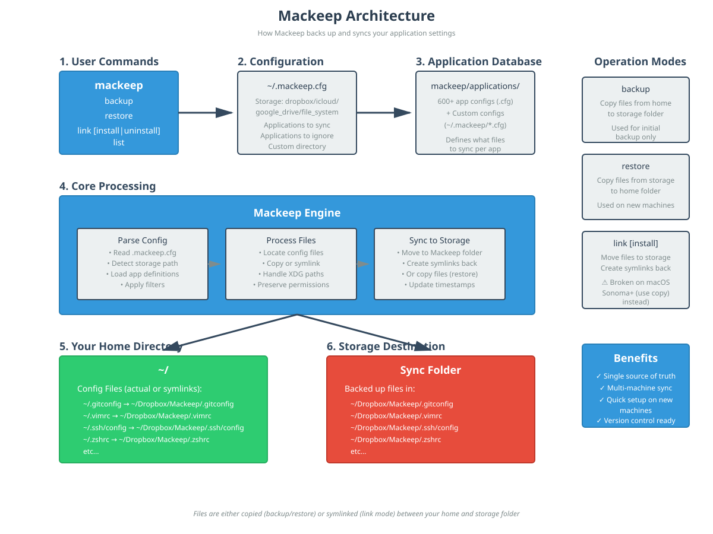

# Mackeep Architecture

This document explains how Mackeep works internally to help contributors
understand the codebase.

## Visual Overview



## Core Concepts

Mackeep is a tool that backs up and syncs application configuration files
across multiple machines using a cloud storage service (Dropbox, Google Drive,
iCloud) or any file system location.

### Operation Modes

Mackeep has two main operation modes:

#### 1. Copy Mode (Recommended)

Copy mode is used for backing up and restoring files:

- **`mackeep-cli backup`**: Copies configuration files from your home directory
  to the Mackeep folder
- **`mackeep-cli restore`**: Copies configuration files from the Mackeep folder
  back to your home directory

This is a one-time operation used when setting up a new machine or creating
an initial backup.

#### 2. Link Mode (Legacy - Not recommended for macOS Sonoma+)

Link mode creates persistent symlinks between your home directory and the
Mackeep folder:

- **`mackeep-cli link install`**: Moves files to Mackeep folder and creates
  symlinks back to original locations
- **`mackeep-cli link`**: Creates symlinks from Mackeep folder to home directory
  (on additional machines)
- **`mackeep-cli link uninstall`**: Removes symlinks and copies files back to
  original locations

⚠️ **Warning**: Link mode is broken on macOS Sonoma (14) and later due to
changes in how macOS handles symlinked preferences. Use copy mode instead.

## Component Architecture

### 1. Command Line Interface (`mackeep_cli/main.py`)

Entry point for the application. Parses command-line arguments using
`docopt` and dispatches to the appropriate operation.

**Key Functions:**

- Argument parsing and validation
- Help text display
- Operation dispatch

### 2. Configuration Manager (`config.py`)

Reads and parses the `.mackeep.cfg` configuration file.

**Configuration Sources (in order of precedence):**

1. `~/.mackeep.cfg`
2. `$MACKEEP_CONFIG` environment variable
3. `$XDG_CONFIG_HOME/mackeep/mackeep.cfg` or `~/.config/mackeep/mackeep.cfg`

**Configuration Options:**

- Storage engine (dropbox, google_drive, icloud, file_system)
- Storage path and directory name
- Applications to sync/ignore
- Custom directory name
- Global exclusion rules, applied to every application

### 3. Application Database (`appsdb.py`)

Manages the database of supported applications and their configuration files.

**Sources:**

- Built-in application configs (`mackeep/applications/*.cfg`)
- User-defined custom configs (`~/.mackeep/*.cfg`)

**Application Config Format:**

```ini
[application]
name = Application Name

[configuration_files]
.config_file
folder/

[xdg_configuration_files]
app/config

[exclude]
folder/cache
**/.DS_Store

[xdg_exclude]
app/cache
```

### 4. Application Handler (`application.py`)

Handles the operations (backup, restore, link) for individual applications.

**Key Operations:**

- File discovery and validation
- Copy operations with permission preservation
- Symlink creation and management
- XDG directory handling
- Conflict detection

### 5. Exclusion Matcher (`excludes.py`)

Holds the immutable `Matcher` class that answers whether a path is excluded
by a set of patterns.

**Key Features:**

- gitignore-like patterns (`*`, `?`, `**`, `!`, trailing `/`)
- Patterns relative to a root (`$HOME` or `$XDG_CONFIG_HOME`)
- The last matching pattern wins, so a pattern can re-include a path
- Case sensitive matching
- No dependency but the standard library

### 6. Core Engine (`mackeep.py`)

Orchestrates the overall backup/restore/link operations across all
applications.

**Workflow:**

1. Load configuration
2. Determine storage location
3. Load application database
4. Filter applications based on config
5. Execute operation on each application
6. Handle errors and report status

### 7. Utilities (`utils.py`)

Common utility functions used throughout the codebase:

- File system operations (copy, delete, symlink)
- Path manipulation and resolution
- XDG directory detection
- Error handling and user prompts
- Storage engine detection (Dropbox, Google Drive, iCloud)

### 8. Migration (`migrate.py`)

Builds the plan of the migration of the legacy Mackup files and copies
them to their new location. The files are copied, never moved nor
deleted.

### 9. JSON Interface (`jsonapi.py`)

Serializes the answers of the `--json` option, meant to be used by the
graphical front-ends built on top of Mackeep.

**Key Features:**

- Every answer holds a `schema_version` field
- Single JSON document or NDJSON stream of events
- Errors are reported as a JSON document, with a non-zero exit code

### 10. INI Files (`inifile.py`)

Reads the config files of the applications and the config file of Mackeep.

A broken rule does not stop Mackeep from working: the rule is skipped and the
problem is reported, with the name of the file it is in. The problems of the
config file of an application are attached to that application, and the
problems of the `.mackeep.cfg` file are attached to the configuration.

## Data Flow

### Backup Flow

```text
User runs: mackeep-cli backup
    ↓
main.py parses command
    ↓
config.py loads .mackeep.cfg
    ↓
appsdb.py loads application definitions
    ↓
mackeep.py iterates through applications
    ↓
application.py for each app:
    - Finds config files in home directory
    - Copies to Mackeep storage folder
    - Preserves permissions and timestamps
    ↓
Files now in: ~/Dropbox/Mackeep/ (or chosen storage)
```

### Restore Flow

```text
User runs: mackeep-cli restore
    ↓
main.py parses command
    ↓
config.py loads .mackeep.cfg
    ↓
appsdb.py loads application definitions
    ↓
mackeep.py iterates through applications
    ↓
application.py for each app:
    - Finds files in Mackeep storage folder
    - Copies to home directory
    - Preserves permissions and timestamps
    ↓
Config files now in home directory
```

### Exclusion Flow

```text
User runs: mackeep-cli backup
    ↓
config.py loads the global [exclude] rules
    ↓
appsdb.py loads the [exclude] and [xdg_exclude] rules of each app
    ↓
application.py for each app, for each config file:
    - Is the file excluded? (excludes.py, relative to $HOME)
    - Is the file excluded? (excludes.py, relative to $XDG_CONFIG_HOME)
    - If yes: skip it, the excluded folders are not walked
    - If no: copy the file, or the folder without its excluded files
    ↓
The files that are already in the backup and that are now excluded are
not deleted, they are only reported
```

### Link Install Flow (Legacy)

```text
User runs: mackeep-cli link install
    ↓
main.py parses command
    ↓
config.py loads .mackeep.cfg
    ↓
appsdb.py loads application definitions
    ↓
mackeep.py iterates through applications
    ↓
application.py for each app:
    - Moves config files to Mackeep storage folder
    - Creates symlinks from original location to storage
    ↓
Files in storage: ~/Dropbox/Mackeep/
Symlinks in home: ~/.config → ~/Dropbox/Mackeep/.config
```

## Key Design Decisions

### 1. Symlinks vs Copies

**Original Design (Link Mode):**

- Symlinks allowed real-time sync across machines
- Changes immediately reflected in cloud storage
- Single source of truth

**Current Recommendation (Copy Mode):**

- macOS Sonoma+ broke symlink support for preferences
- Copy mode is more reliable across platforms
- Trade-off: manual sync required (re-run backup/restore)

### 2. Application Database

- **Centralized definitions**: All supported apps in
  `mackeep/applications/`
- **User extensibility**: Custom apps via `~/.mackeep/*.cfg`
- **Simple format**: INI-style configuration files
- **Override capability**: User configs override built-in ones

### 3. The Applications of the User

- **The list of the user**: the desktop application shows the applications
  of the user and the ones that were added from the library, nothing else
- **The library**: the applications of the database are a catalog, they are
  added to the list of the user when they are needed
- **The applications of the library are read only**: they have to be copied
  to be changed
- **The checkbox is manual**: the applications that are checked are the ones
  that are backed up, the list of the applications to sync is the one that
  tells what is backed up
- **The search of the files**: the editor of an application can look for the
  files and the folders of the application, in the folders of its config, in
  the standard places of macOS and in the whole disk with Spotlight, and add
  the ones that are found to the application

### 3. Storage Abstraction

- **Multiple backends**: Dropbox, Google Drive, iCloud, file system
- **Auto-detection**: Automatically finds storage paths
- **Flexibility**: Custom paths for any sync solution

### 4. Backward Compatibility

- **The legacy files are not read**: the config file and the custom
  application configs of Mackup are ignored, only the Mackeep ones are
  used
- **The storage folder**: the legacy `Mackup` folder is not used any more,
  the `Mackeep` one is
- **A migration command**: `mackeep-cli migrate` copies the legacy files to
  their new location, without overwriting anything
- **One warning per run**: the legacy paths that have to be migrated are
  reported in `stderr`

### 5. Exclusions

- **Gitignore-like**: The patterns follow the `.gitignore` semantics, so
  they are familiar
- **Relative to a root**: The `[exclude]` patterns are relative to `$HOME`,
  the `[xdg_exclude]` ones to `$XDG_CONFIG_HOME`
- **Global and per app**: The `.mackeep.cfg` file may hold an `[exclude]`
  section that applies to every application
- **Copy mode only**: A symlink cannot exclude anything, so the link mode
  skips the entries that are impacted by the exclusion rules
- **Broken rules are skipped**: A rule that cannot be used does not stop
  Mackeep from working, it is reported with the name of its file

### 6. XDG Support

- **Standards compliance**: Respects XDG Base Directory Specification
- **Flexibility**: Handles non-standard `$XDG_CONFIG_HOME`
- **Separate section**: `[xdg_configuration_files]` in app configs

## File Structure

```text
src/
├── mackeep/            # The core: the engine and the JSON interface
│   ├── mackeep.py      # Core orchestration engine
│   ├── config.py       # Configuration management
│   ├── appsdb.py       # Application database
│   ├── application.py  # Per-application operations
│   ├── excludes.py     # Exclusion rules (gitignore-like matcher)
│   ├── inifile.py      # Reading of the INI config files
│   ├── migrate.py      # Migration of the legacy Mackup files
│   ├── jsonapi.py      # Machine-readable JSON output
│   ├── utils.py        # Utility functions
│   ├── constants.py    # Constants and defaults
│   └── applications/   # Built-in app configs
│       ├── git.cfg
│       ├── vim.cfg
│       ├── ssh.cfg
│       └── ... (600+ more)
└── mackeep_cli/        # The terminal version
    └── main.py         # CLI entry point
```

The desktop version lives in `desktop/` and is written in SwiftUI. It talks to
the terminal version through the JSON interface, so it does not need anything
but the core.

```text
desktop/
├── project.yml        # The project of XcodeGen, the project file is generated
├── Sources/
│   ├── App/
│   │   ├── App/       # The entry point and the shared state of the windows
│   │   ├── Core/      # The INI parser, the models, the runner of the tool
│   │   └── Features/  # The sections: Applications, Editor, Backup, Settings
│   └── Resources/     # The strings of the interface
├── Tools/
│   ├── Translations.py  # The names of the languages and the loader
│   └── languages/      # One file per language, they can be changed alone
└── Tests/             # The unit tests and the UI tests
```

### The languages of the interface

The strings of the interface live in the string catalog of the application
(`Sources/App/Resources/Localizable.xcstrings`). The translation of every
language lives in its own file, in `Tools/languages`, named after the code of
the language: `uk.py`, `de.py`, `es.py`… A language can be added or changed
without touching the other ones, so a translator can work on one language and
push it alone.

The script `Tools/apply_translations.py` pours the files of the languages into
the string catalog, which is what Xcode reads to build the `.lproj` folders
of the application.

## Extension Points

### Adding a New Application

Create `mackeep/applications/myapp.cfg`:

```ini
[application]
name = My Application

[configuration_files]
.myapprc
.myapp/

[xdg_configuration_files]
myapp/config.yml
```

Submit PR with the new config file.

### Excluding Some Files of an Application

Add an `[exclude]` section to the config file of the application:

```ini
[application]
name = My Application

[configuration_files]
.myapp/

[exclude]
.myapp/cache
```

### Adding a New Storage Backend

1. Extend `config.py` to detect new storage location
2. Add storage type to `constants.py`
3. Implement path detection in `utils.py`
4. Update documentation

### Custom File Sync

Users can sync any files by creating `~/.mackeep/custom.cfg`:

```ini
[application]
name = My Custom Files

[configuration_files]
.custom_file
custom_directory/
```

## Testing Strategy

The codebase includes comprehensive unit tests:

- **`tests/test_application.py`**: Application operations
- **`tests/test_config.py`**: Configuration parsing
- **`tests/test_utils.py`**: Utility functions
- **`tests/test_cli.py`**: Command-line interface
- **`tests/test_main.py`**: Main entry point
- **`tests/test_excludes.py`**: Exclusion matcher
- **`tests/test_exclude_integration.py`**: Exclusions in the backup and
  restore flows
- **`tests/test_json.py`**: Machine-readable JSON output

Tests use temporary directories and mock file systems to avoid affecting
the actual system.

## Error Handling

Mackeep includes several safety mechanisms:

1. **Confirmation prompts**: Asks before destructive operations
2. **Conflict detection**: Warns if files exist in both locations
3. **Dry-run capability**: Can preview operations (future enhancement)
4. **Graceful degradation**: Continues with other apps if one fails
5. **Clear error messages**: Helps users understand what went wrong
6. **Machine-readable errors**: In the `--json` mode, the errors are
   reported as a JSON document, with a non-zero exit code

## Performance Considerations

- **Sequential processing**: Processes one application at a time
- **File-by-file operations**: No batch operations for reliability
- **No caching**: Reads fresh data on each run
- **Minimal dependencies**: Only requires `docopt-ng` for CLI parsing

## Future Enhancements

Potential improvements to the architecture:

1. **Progress indicators**: Show progress during long operations
2. **Dry-run mode**: Preview changes without executing, already available
   with `--dry-run`
3. **Incremental sync**: Only sync changed files
4. **Parallel processing**: Speed up operations on multi-app backups
5. **Conflict resolution**: Better handling of file conflicts
6. **Rollback capability**: Undo operations if something goes wrong

## Contributing

See [CONTRIBUTING.md](../.github/CONTRIBUTING.md) and
[develop.md](develop.md) for guidelines on contributing to Mackeep.
