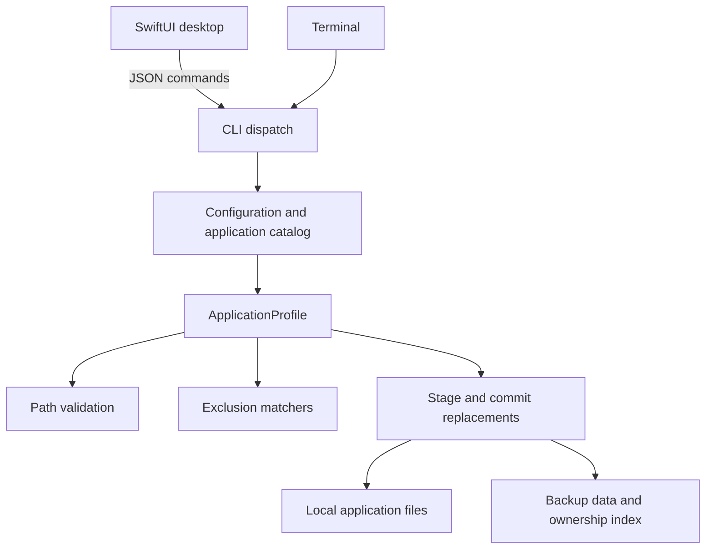

# Architecture

Mackeep has a Python core, a CLI, and a SwiftUI desktop application. Both user
interfaces use the same INI configuration and application definitions. The
desktop delegates filesystem operations to the CLI through JSON.

## Code map

| Location | Responsibility |
| --- | --- |
| `src/mackeep_cli/main.py` | Argument parsing, selection, preflight, dispatch, text/JSON reporting, exit status |
| `src/mackeep/config.py` | Main-config discovery, initialization, storage, selection, security policy |
| `src/mackeep/mackeep.py` | Configuration state, storage environment checks, and application selection |
| `src/mackeep/appsdb.py` | Built-in/custom definitions and loading diagnostics |
| `src/mackeep/application.py` | Per-application backup, restore, link operations, planning, and exclusion preservation |
| `src/mackeep/excludes.py` | Parsed rules and immutable-by-interface matchers |
| `src/mackeep/paths.py` | HOME/external mapping, containment, and overlap checks |
| `src/mackeep/transaction.py` | Staging, replacement, rollback, and temporary-version cleanup |
| `src/mackeep/backupstate.py` | Validated per-application leaf ownership |
| `src/mackeep/inifile.py` | INI parsing and duplicate-section/option diagnostics |
| `src/mackeep/jsonapi.py` | JSON serialization and schema version |
| `src/mackeep/migrate.py` | Non-overwriting copies from legacy Mackup locations |
| `src/mackeep/utils.py` | Copying, permissions, prompts, provider detection, sensitive-path warnings |
| `src/mackeep/constants.py` | Names, storage engines, version lookup, sensitive patterns |
| `src/mackeep/applications/` | Built-in `.cfg` definitions |
| `desktop/Sources/App/` | SwiftUI application, models, configuration editing, CLI adapter |

The runtime dependency is `docopt-ng`; the rest of the Python core uses the
standard library. Python 3.14+ is required for source execution. Distributed
standalone binaries carry their runtime.

## Command lifecycle

1. Parse arguments. Migration uses its own path and does not require a working
   new storage configuration.
2. Load the main config and catalog. Dry-run uses read-only config initialization.
   Custom definitions override built-in files by filename.
3. Resolve the selected apps. The CLI reuses its loaded catalog; a named app
   overrides selection/ignore lists. Legacy full-link restoration reloads the
   config/catalog after restoring Mackeep's own configuration.
4. Validate selected paths before initializing backup data. Entry-level checks
   run again before operations. External permission does not bypass containment
   or source/destination overlap checks.
5. Process applications sequentially. Expected per-application I/O failures are
   reported while other apps continue. Any failed application makes the final
   exit status nonzero.

See [configuration and operation behavior](README.md) for user-facing rules.

## Replacement transactions

`ApplicationProfile` builds fresh replacements in `.mackeep-*` workspaces
beside each destination so commit uses same-filesystem renames. Preparation
finishes for the application before existing destinations are replaced.

Commit moves old destinations into their workspaces, then installs staged
values. On failure, completed changes are reversed. Old versions are deleted
only after commit or successful rollback. If rollback fails, workspaces remain
and their locations are reported.

The boundary is one application, not the entire command. This is rollback for
handled errors, not a durable crash-recovery journal or a lock against other
processes. Concurrent writers are unsupported. Copy events are buffered during
staging and published after commit, so consumers do not mistake staged data for
completed writes.

## Ownership and exclusions

The backup index `.mackeep-state/owners.json` maps application identifiers to
relative leaf paths, including links and empty directories. Its update is
staged with the data. This supports cleanup when a definition removes a path,
while retaining other applications' leaves in shared directories.

On the first indexed backup, the CLI infers a baseline from current definitions,
including configured ignored apps. Historical paths removed before that index
cannot be inferred. A still-listed missing source or declined replacement
retains its previous ownership. Malformed index data refuses cleanup.

HOME and XDG matchers are separate. Global rules precede per-app rules; the
last match wins within a matcher. `Matcher` searches backward for that rule,
but still checks ancestor exclusion because excluded directories are not walked.
Pattern provenance is retained for JSON explanations. Empty matchers bypass
normalization and needless XDG or directory work.

Backup copies current allowed files, grafts shared owned leaves into the stage,
and schedules obsolete tracked leaves for removal. Restore instead preserves
excluded local entries. Nested symlinks are leaves, never recursive targets.

## JSON boundary

The contract is schema **4**, shared with `MackeepSchema` in desktop models.
`config`, `list`, `show`, migration, and dry-run return one JSON document;
execution of backup/restore returns NDJSON. Human diagnostics go to stderr.

The dry-run reporter retains at most `max_actions` actions and accumulates
complete summaries during traversal. Other traversal structures can still grow.
Execution counters reset per application. A `done` event is not a success flag;
clients must inspect errors and process exit status.

Breaking changes require a schema bump, updated [JSON documentation](README.md#json-interface),
and matching desktop handling. Existing field names remain part of the public
contract.

## Desktop integration

The app discovers a separately installed CLI, reads capabilities, and uses
JSON models to drive Applications, Backup/Restore, Editor, and Settings.
Built-in definitions are read-only in the editor until copied into custom
configuration. Application selection is written off the main thread; operations
wait for pending saves before reading it.

`MainConfig` serializes writes within the process and merges edited keys/sections
into the latest file, avoiding stale settings and selection snapshots overwriting
each other. This is not a cross-process configuration lock. Language, appearance,
and onboarding preferences use `UserDefaults`; backup configuration remains in
the shared INI files.

Translations live in `desktop/Tools/languages/*.py` and generate
`desktop/Sources/App/Resources/Localizable.xcstrings` using
`desktop/Tools/apply_translations.py`. The Xcode project is generated from
`desktop/project.yml`. See the [desktop guide](../desktop/README.md).

## Validation and extension

Use [development checks](develop.md) and [test conventions](../tests/README.md).
Filesystem tests need temporary HOME/XDG paths and disposable data. Preserve
rollback, ownership, exclusions, path policy, symlink handling, and JSON behavior
when changing the copy pipeline.

Add built-in applications as `.cfg` files, not Python branches. A new storage
engine needs constants, config/path detection, tests, and desktop support.
Runtime dependencies remain limited to the standard library and `docopt-ng`.
